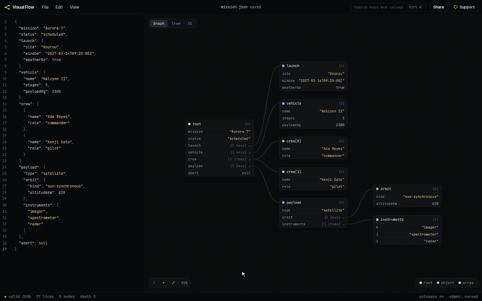
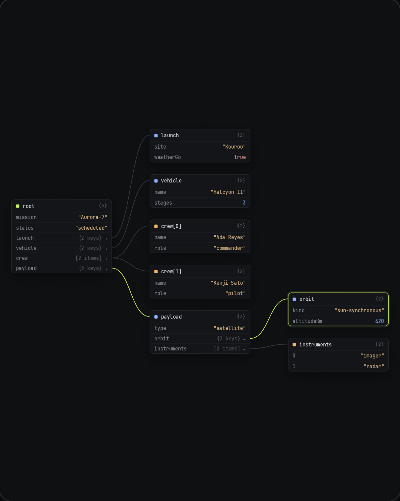
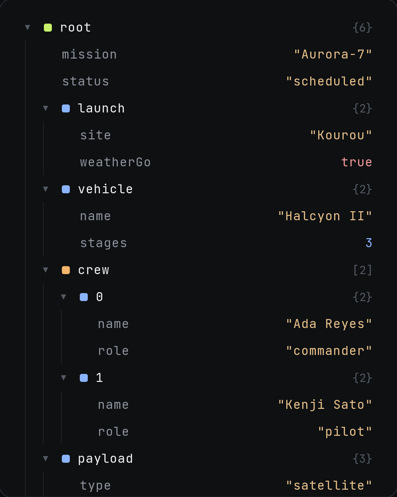
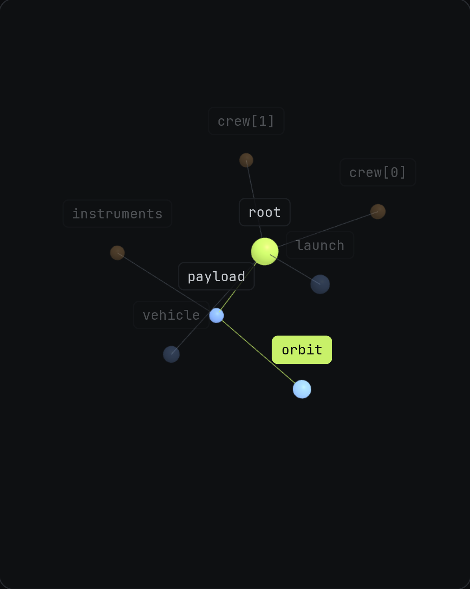

<h1>&nbsp;Visual Flow</h1>

**See the shape of your JSON.** Paste any JSON and explore it as a graph, a foldable tree or a 3D model. It's free, needs no account, and nothing leaves your browser.

**[Open the editor →](https://visualflow.tickshift.dev/editor)** &nbsp;·&nbsp; [Try it with a sample file](https://visualflow.tickshift.dev/editor#s=dVFBTsMwEPxKtOdUCikCkRsnQL0BJ3APS7JqDI43stdUEerfke0QUiROlnbGM7OzX_AJzUUJ79DAl7JFoWDQ3mu2CppCwW1w7HBzraDMqBeU4DPo2566YKhbUIPBtn1Ek1j6oIUyfcfBcZi5ETpq2_Exg3VVX2-q7ebi8rm6aeqqqaqXNZVQenJ3HNniAkXgNLt-Uq9bQ2e2FofZ9h5NO7EtHh5Wel7wQGmN7TIbcTKM3e4Qx_W2qtYeraOU9DWzZ59zp9sOi0eaom75izvO0RS0PAxoO3IKMpzF_1HbkX3XxRMK_yM3asOySMVnP4edNzkrRKZx_udRyJh0lmV3dm9aVvw4-9A2SSjwwW78ZNveseV4_VUeNKIldLQbIveqTq39rqZAWy8uDGQl9T0XmJABD7GMlZofqRXHA8kfwGGHS2_79WXwjV2KboMxyp6ghCM0cHA49lCCh-b1pxAo86KwP30D) &nbsp;·&nbsp; [Sponsor ♥](https://github.com/sponsors/samizak)



## Why

JSON you didn't write is hard to read. A response with six levels of nesting tells you very little as text, and a lot once you can see which objects hang off which. Visual Flow draws that structure, lets you click around it, and points you back to the exact lines in the file.

## Three views of the same file

| Graph | Tree | 3D |
|---|---|---|
|  |  |  |
| Node cards with every key and value. Follow the links, fold branches, drag things around. Lays out left to right or top to bottom. | An indented outline you can fold, like a file explorer. The one to use when a file is too big for a graph. | Every object as a point in space. Turn it to get a feel for how big and how deep a file is. |

Your selection and search carry across all three, so you can switch views without losing your place.

## Features

- **Click a node, find its code.** Select anything and its lines are highlighted in the editor, which scrolls to them.
- **Inspector.** See a node's path, type and contents, and copy its JSONPath, a JavaScript accessor or the value.
- **Search.** Matches for a key or value light up in whichever view you're in, and everything else fades.
- **Share links.** Copy a link that holds the file, the open view and the selection. The data is compressed into the link itself, so nothing is uploaded or stored. [Here's one](https://visualflow.tickshift.dev/editor#s=dVFBTsMwEPxKtOdUCikCkRsnQL0BJ3APS7JqDI43stdUEerfke0QUiROlnbGM7OzX_AJzUUJ79DAl7JFoWDQ3mu2CppCwW1w7HBzraDMqBeU4DPo2566YKhbUIPBtn1Ek1j6oIUyfcfBcZi5ETpq2_Exg3VVX2-q7ebi8rm6aeqqqaqXNZVQenJ3HNniAkXgNLt-Uq9bQ2e2FofZ9h5NO7EtHh5Wel7wQGmN7TIbcTKM3e4Qx_W2qtYeraOU9DWzZ59zp9sOi0eaom75izvO0RS0PAxoO3IKMpzF_1HbkX3XxRMK_yM3asOySMVnP4edNzkrRKZx_udRyJh0lmV3dm9aVvw4-9A2SSjwwW78ZNveseV4_VUeNKIldLQbIveqTq39rqZAWy8uDGQl9T0XmJABD7GMlZofqRXHA8kfwGGHS2_79WXwjV2KboMxyp6ghCM0cHA49lCCh-b1pxAo86KwP30D): it opens a sample file with one node already selected.
- **Export.** Save the graph or tree as PNG, JPG or true vector SVG, and the 3D view as PNG or JPG.
- **Import.** Open or drop in `.json` and `.txt` files, or just paste.
- **Editor.** Monaco (the editor from VS Code), with errors flagged as you type and autosave to your browser.
- **Works on phones.** The code sits above the views, and the inspector becomes a bottom sheet.

## Private by design

There is no server side. Parsing, layout and drawing all happen in your browser, your work is saved in your browser's own storage, and share links carry their data after the `#`, which browsers never send to a server. There are no accounts, no tracking of your files, and no API keys.

## Run it locally

You need Node.js 20 or newer.

```bash
git clone https://github.com/TickshiftLabs/Visual-Flow.git
cd Visual-Flow
npm install
npm run dev
```

Then open [http://localhost:3000](http://localhost:3000). No environment variables are needed.

Sample files to try are in [`samples/`](samples), from a small order to a 50-order export.

## Tests

```bash
npm test            # unit tests (Jest), a few seconds
npm run test:e2e    # browser tests (Playwright), about half a minute
```

The browser tests use your installed Google Chrome and start the dev server themselves if it isn't running.

## Built with

- [Next.js 16](https://nextjs.org) and [React 19](https://react.dev), with [Tailwind CSS 4](https://tailwindcss.com)
- [React Flow](https://reactflow.dev) and [dagre](https://github.com/dagrejs/dagre) for the graph and its layout
- [three.js](https://threejs.org) for the 3D view
- [Monaco Editor](https://microsoft.github.io/monaco-editor/) for the code panel
- [Zustand](https://github.com/pmndrs/zustand) for state
- [Jest](https://jestjs.io) and [Playwright](https://playwright.dev) for tests

## Project layout

```
app/
  page.tsx            landing page (sections in landing-page/components)
  editor/             the editor
    components/
      Layout/         top bar, menus, status bar, settings
      Panel/          code panel, views panel, inspector
      Visualizers/    graph, tree and 3D views, and the graph model they share
components/           logo, toasts and shared UI pieces
store/                app state (Zustand)
utils/                export, share links, storage
e2e/                  browser tests
samples/              example JSON files
scripts/              records the landing page's demo clips
```

## Support

Visual Flow is free and will stay that way. If it saves you time, you can [support the project](https://github.com/sponsors/samizak).

## License

[MIT](LICENSE)
